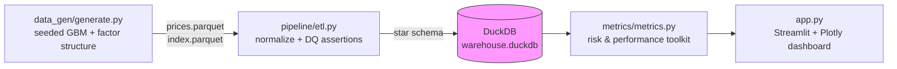

# Portfolio Risk & Performance Lab

[](https://www.python.org/)
[](https://duckdb.org/)
[](https://streamlit.io/)
[](tests/test_metrics.py)
[](LICENSE)

An institutional-style portfolio risk & performance lab on a proper
analytics-engineering foundation: seeded synthetic daily prices for 40
equities across 5 sectors (geometric Brownian motion with a sector-factor
structure, so cross-asset correlations behave like real equities) flow
through an ETL pipeline into a DuckDB star schema; a metrics layer computes
the standard risk/performance toolkit; a Streamlit + Plotly app presents it —
KPI cards, equity curves, an underwater drawdown chart, VaR/CVaR panels,
factor exposures, and a Monte Carlo efficient frontier.

## Live demo

🚀 **Live demo:** https://portfolio-risk-lab.streamlit.app/

## Features

- **Seeded, deterministic data** — 40 tickers × 5 sectors × 756 trading days
  (~3 years) from a fixed numpy seed: market + sector factors plus
  idiosyncratic noise. A synthetic cap-weighted index is the benchmark. No
  API keys, no downloads; every run is byte-identical.
- **Star schema in DuckDB** — `dim_ticker`, `dim_date`, `fact_daily_prices`,
  `fact_returns` (log + simple), `fact_market_index`, with a documented
  dbt-model mapping in `pipeline/schema.sql`. The ETL carries
  data-quality assertions (no bad closes, return-row arithmetic).
- **Full risk/performance toolkit** — total & annualised return, volatility,
  Sharpe, Sortino, max drawdown (+ duration & recovery), historical VaR/CVaR
  (95%, 99%), rolling 30-day volatility, sector correlation, OLS factor
  exposures (market/size/value/momentum proxy factors).
- **Monte Carlo efficient frontier** — 2,000 random long-only portfolios from
  the annualised mean/covariance, with max-Sharpe and min-variance portfolios
  highlighted and a full weights table.
- **Tested** — pytest suite covering return compounding, Sharpe/Sortino vs
  manual arithmetic, drawdown invariants and recovery, VaR quantile
  properties, correlation bounds, factor-beta recovery, and frontier
  constraints (weights sum to 1, max-Sharpe ≥ benchmark Sharpe).

## Quickstart

```bash
# 1. Create a virtualenv and install
python -m venv .venv && source .venv/bin/activate
pip install -r requirements.txt

# 2. Generate the seeded data and build the DuckDB warehouse
python -m data_gen.generate
python -m pipeline.etl

# 3. Run the tests
pytest -q

# 4. Launch the dashboard
streamlit run app.py
```

## Architecture



## Project structure

```text
portfolio-risk-analytics/
├── app.py                  # Streamlit dashboard (6 panels)
├── data_gen/
│   └── generate.py         # seeded daily closes: 40 tickers × 5 sectors × ~3Y
│                           # GBM with market + sector factors; cap-weighted index
├── pipeline/
│   ├── etl.py              # parquet/CSV -> DuckDB star schema + DQ assertions
│   └── schema.sql          # DDL with dbt-model mapping
├── metrics/
│   └── metrics.py          # returns, vol, Sharpe/Sortino, drawdown, VaR/CVaR,
│                           # correlation, factor betas (OLS), efficient frontier
├── tests/
│   └── test_metrics.py     # 10 tests: return arithmetic, Sharpe vs manual,
│                           # drawdown invariants, VaR quantile, beta recovery…
├── requirements.txt
├── Dockerfile              # self-contained image: bakes dataset + warehouse
├── .gitignore
└── LICENSE                 # MIT
```

## Modelling notes

- **All prices are synthetic** — generated from a fixed seed; the "market"
  factors (size = small−big cap, value = low−high beta, momentum =
  winners−losers) are labelled in-app as proxies, not Fama-French data.
- **The portfolio is daily-rebalanced equal-weight** across the 40 tickers;
  the benchmark is a synthetic cap-weighted index built from the same price
  paths.
- **Historical VaR** is the empirical quantile (no normality assumption);
  CVaR is the mean loss beyond VaR.

## Production extensions

How this would grow into a production quant-analytics stack:

- **dbt + Snowflake/BigQuery** — the `schema.sql` comments already map each
  table to its dbt mart model; promote the pandas transforms to versioned
  dbt models with tests and docs.
- **Orchestration** — schedule `generate → etl` on Airflow/Dagster; move to
  incremental daily loads (merge on `(date, ticker)`) instead of full
  rebuilds.
- **Data quality** — Great Expectations / dbt tests on the return-row
  identity, FK integrity and close-price sanity, alerting on breach.
- **Real market data** — swap the seeded generator for a vendor feed
  (e.g. Polygon, Tiingo, or exchange bhavcopy files) landing in an
  append-only raw zone (S3 + Iceberg/Delta); keep the metrics layer
  untouched.
- **Risk models** — replace the equal-weight toy portfolio with holdings from
  a portfolio system; add Barra-style factor risk decomposition, stress
  scenarios, and parametric VaR with volatility clustering (GARCH).
- **Serving** — cache the metrics layer (Parquet mart / Redis), add auth and
  audit logging before exposing the dashboard beyond the desk.
